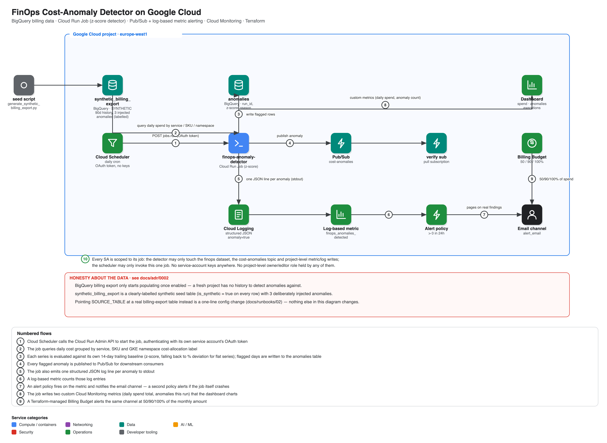

# FinOps Cost-Anomaly Detector on Google Cloud

A **FinOps cost-anomaly detection platform** for GCP/GKE spend: a scheduled Cloud Run
Job evaluates daily cost per service/SKU/**GKE namespace cost-allocation label** against
a 14-day trailing z-score baseline, writes flagged days to BigQuery, publishes them to
Pub/Sub, and pages through a Cloud Monitoring log-based-metric alert — all provisioned
and destroyed by **one script each**, with a Billing Budget and dashboard alongside.

> **Status: deployed and verified live** (europe-west1, 2026-09-27). A from-scratch
> `./scripts/up.sh` built the whole stack and [`scripts/test.sh`](scripts/test.sh)
> passed **21 of 21** ([results](docs/test-results.md)), including all 3 deliberately
> injected synthetic anomalies correctly detected with zero false positives. The first
> live run *did* find a real bug — the custom-metrics writer crashed the job after it had
> already written its results — fixed and documented in
> [runbook 04](docs/runbooks/04-troubleshooting.md); the from-scratch run above is with
> that fix in place. The stack was then removed with `./scripts/down.sh` — nothing
> billable left running (confirmed below).

```bash
gcloud config set project <your-project>      # billing linked; the rest is auto-detected
./scripts/up.sh       # infra -> seed synthetic billing data -> build -> job + scheduler -> detect -> live tests
./scripts/down.sh     # delete everything (--purge also drops the Terraform state)
```

## What it proves

| Concern | Mechanism | Proven by |
|---|---|---|
| **Anomalies are actually caught, not just claimed** | Trailing 14-day z-score per (service, SKU, GKE namespace label), falling back to % deviation for flat series | test §4: all 3 injected synthetic anomalies captured, 0 false positives, 0 missed |
| **No history on day one is handled honestly** | A clearly-labelled **synthetic** seed table (`is_synthetic = true` on every row) stands in for a fresh billing export until real history exists | test §2; [ADR 0002](docs/adr/0002-synthetic-seed-data-for-anomaly-baseline.md); never blurred with real data anywhere in this repo |
| **Findings reach someone** | Structured log → log-based metric → Cloud Monitoring alert policy (email); a second policy pages if the job itself crashes | test §5 |
| **Findings are integrable, not a dead end** | Every anomaly is also published to Pub/Sub | test §5: message pulled from a dedicated verification subscription |
| **Spend has a backstop** | Terraform-managed Billing Budget, 50/90/100% thresholds | test §6 |
| **Least privilege, no keys** | Three service accounts, each scoped to one job; no project-level owner/editor; no service-account keys anywhere | test §7 |
| **The whole thing is reproducible** | One script builds it, one tears it down, CI regenerates the synthetic seed and diffs it against what's checked in | `scripts/up.sh` / `down.sh`; `.github/workflows/ci.yml` `seed` job |

## Architecture

[](docs/img/architecture.svg)

<sub>Click for the vector version. Numbered steps trace the flow; the legend under the diagram explains each one. Diagram source: [`docs/diagrams/architecture.py`](docs/diagrams/architecture.py).</sub>

More: [architecture](docs/architecture.md) · [threat model](docs/threat-model.md)

## Design decisions

| ADR | Decision | Trade-off called out |
|---|---|---|
| [0001](docs/adr/0001-cloud-run-job-over-cloud-function.md) | Cloud Run Job, not a Cloud Function or service | No built-in cross-invocation retry/backoff (rely on idempotent reruns) |
| [0002](docs/adr/0002-synthetic-seed-data-for-anomaly-baseline.md) | Clearly-labelled synthetic seed data for the baseline | Proves the *method*, not that it's caught a real anomaly yet |
| [0003](docs/adr/0003-log-metric-and-pubsub-for-alerting.md) | Log-based metric for paging + Pub/Sub for integration, not one merged mechanism | Two things to keep in sync instead of one |
| [0004](docs/adr/0004-no-external-wif-ci-is-lint-only.md) | No GitHub-Actions WIF; CI is lint/validate/scan only | CI never touches the live project — by design, not oversight |

[Threat model](docs/threat-model.md) maps every STRIDE threat to a control **and the test that proves it**.

## Runbooks

[docs/runbooks](docs/runbooks/README.md): build & teardown · run detection and inspect results (including pointing at a real billing export) · cost · troubleshooting (the real bug this build hit).

## Repository layout

```
terraform/   BigQuery (dataset + tables), Pub/Sub, Cloud Run Job, Scheduler, IAM, monitoring, budget
app/         detector/ — anomaly.py (z-score logic, unit tested) + main.py (Cloud Run Job entrypoint)
seed/        generate_synthetic_billing.py — deterministic SYNTHETIC seed data + ground truth
scripts/     up.sh · down.sh · test.sh · bootstrap.sh
docs/        architecture · threat model · ADRs · runbooks · diagrams · seed-anomalies.json (ground truth)
```

## Cost & safety

Well under €0.10 for a full build–test–teardown session: Cloud Run Job bills only while
an execution runs, BigQuery/Pub/Sub/Monitoring usage is a rounding error against their
free tiers, and a Terraform-managed Billing Budget bounds total spend regardless. See
[runbook 03](docs/runbooks/03-cost.md). `down.sh` deletes the BigQuery dataset with its
data and reports 0 across every category it checks.

## Known gaps (deliberate)

Detection quality is proven against clean, synthetic, deliberately-injected spikes, not
genuinely noisy real-world spend with real seasonality (release trains, month-end batch
jobs) — see [ADR 0002](docs/adr/0002-synthetic-seed-data-for-anomaly-baseline.md) ·
no seasonality/ML model, a plain trailing z-score with a percentage-deviation fallback ·
no real external notification integration (Slack/ticketing) beyond the Pub/Sub
integration point — deliberately not wired to a live webhook for this build · no CMEK on
the BigQuery dataset · no VPC-SC perimeter · single region · no GitHub-Actions WIF for CI
since CI never touches the live project ([ADR 0004](docs/adr/0004-no-external-wif-ci-is-lint-only.md)).
See the [threat model](docs/threat-model.md) for the full picture.

## License

MIT
